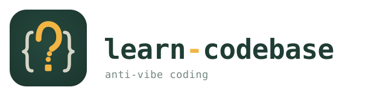

<p align="center">
  <picture>
    <source media="(prefers-color-scheme: dark)" srcset="logo-dark.svg">
    <source media="(prefers-color-scheme: light)" srcset="logo-light.svg">
    
  </picture>
</p>
<p align="center">
  <a href="README.md">English</a> · <b>简体中文</b>
</p>
<p align="center">
  <strong>一个反 vibe coding 的 Skill。</strong>它是一位苏格拉底式导师，通过提问和主动回忆带你真正读懂代码库——因为在成熟项目上，理解比速度更重要。
</p>
<hr>
<p align="center">
  <a href="https://skills.sh/ktaletsk/learn-codebase/learn-codebase"></a>
</p>

> 本文是英文 README 的中文翻译。如有出入，以[英文版](README.md)为准。

适用于上手大型仓库、准备提交 PR，或者在不装懂的前提下处理遗留代码。
在成熟项目上，理解比速度更重要。


## 2 分钟上手

1. 用 [`npx skills`](https://www.npmjs.com/package/skills) 安装这个 Skill（其他安装方式见[安装](#安装)）
2. 打开任何一个你想读懂的项目
3. 输入 `/learn-codebase` 开始一次学习会话

示例（全局安装一次，所有项目都能用，然后打开一个仓库）：

```bash
npx skills add ktaletsk/learn-codebase -g
cd /path/to/repo-you-want-to-learn
# 然后在你的 AI Agent 中输入：
/learn-codebase
```

接下来会发生什么：
- 它会先问你想学什么
- 它会让你先预测、再揭晓答案，让你没法绕过自己的知识盲区
- 它会在 `.claude/learning-journal.md` 中维护一份学习日志，记录哪些你是真懂了、哪些还在不懂装懂
- 它会帮你建立一个对话结束后依然留在脑子里的心智模型

> **有收获吗？** 如果它真的帮你读懂了某个代码库，欢迎[分享你的故事](https://github.com/ktaletsk/learn-codebase/issues/new?title=Story:+&labels=show+%26+tell&body=What+codebase+were+you+learning%3F%0AWhat+clicked+that+hadn%27t+before%3F%0AAnything+surprising+about+the+experience%3F)；如果觉得有用，也请给仓库[点个 Star](https://github.com/ktaletsk/learn-codebase)。

## 适合谁

**非常适合：**
- 正在熟悉陌生代码库或成熟代码库的工程师
- 准备提交第一个有分量的 PR 的开源贡献者
- 想真正理解代码、而不只是生成代码的开发者和学生
- 需要调试或重构别人写的系统的人
- 愿意大声说出“其实我不懂”，而不是一味点头的人

**可能不适合：**
- 速度比深度更重要的从零原型开发
- “直接给我补丁就行”的工作流
- 希望 AI 立刻给出答案、不要追问的人
- 只想要“懂了”的感觉，却不想为此下功夫的人

## 为什么做这个

AI 编程工具让你很容易交付自己并不理解的代码——更糟的是，还很容易让你*觉得*自己理解了。
对从零开始的新项目来说，这没什么问题。但在一个有真正质量标准的成熟代码库里，
“在我机器上能跑”恰恰会让你写出一个在评审中站不住脚的 PR。

这个 Skill 就是你开始 vibe coding 时放弃掉的那份“阻力”。
它把默认的 AI 交互模式反了过来：

| | 常规 AI 编程 | learn-codebase |
|---|---|---|
| 立刻给出代码 | ✅ | ❌ 先让你预测 |
| 回答你的问题 | ✅ | ❌ 反过来问你澄清性问题 |
| 优化速度 | ✅ | ❌ 优化记忆留存 |
| 会话之间会遗忘 | ✅ | ❌ 维护学习日志 |
| 让你产生依赖 | 😬 | ❌ 培养你的独立性 |

## 问题所在

你一定有过这种感觉：大量依靠 AI 写代码之后，就像戴着脚蹼游了很久，突然把它摘掉。
技能退化是真实存在的，但这还是小问题。更大的问题是：你以为自己懂的，
和你真正能讲清楚、站得住的，之间存在一道鸿沟。

2025 年的一项研究发现，开发者在熟悉的代码库上使用 AI 时，速度反而*慢*了 19%，
却自认为快了 20%。这 39 个百分点的落差，就是不对自己诚实的代价。

**这个 Skill 适用于你需要真正学会的时候**，而不只是感觉自己很高效：
- 熟悉新团队的代码库
- 准备为开源项目做贡献
- 在重构之前先读懂遗留代码
- 在代码评审前建立信心——靠真本事挣来的那种，而不是靠感觉

## 实战检验

在一个热门开源项目上做过测试（月下载量 500 万以上，大型 TypeScript monorepo）。

**起点：** 需要为上传流程贡献代码，但对整体架构还没有可靠的心智模型。

**这个 Skill 做了什么：**
- 在展示代码之前先要求做出预测
- 暴露出对 `AbortController` 的一个误解
- 在深入具体文件之前，先把讨论保持在架构层面
- 把进度记录到学习日志里，留给下一次会话

**大约 30 分钟后的结果：**
- 2 个概念从 🔴 升到 🟡
- 记录下 1 个顿悟时刻
- 学习者用自己的话，独立梳理出完整的上传流程
- 信心从“也许能试着改改”变成了“不用装懂也能动手实现”

### 实际效果对比

| 场景 | 常规 AI Agent | learn-codebase |
|----------|---------------------|----------------|
| “上传是怎么实现的？” | 直接倾倒一大堆代码 | “你*预期* `upload()` 会返回什么？” |
| 用户不了解 AbortController | 默认你已经懂了，或者解释过度 | 发现知识缺口，简单解释后回到提问 |
| 复杂的架构 | “这里有 5 个文件要读” | “从概念上看，它分为三层：UI、Model、Services” |
| 会话结束 | “还有什么需要随时告诉我” | “下一步有 4 个具体选项” |
| 下一次会话 | 从头开始 | 读取日志：“上次你探索了上传流程……” |

## 为什么不直接按平常的方式用 Agent

大多数编程 Agent 的调教目标是**完成任务**：给出答案、帮你解围、继续往下。这个 Skill 的目标是**让你能讲清楚自己交付了什么**——目标不同，阻力也不同。你用的还是同一个 Agent，只是多了一种抵抗“虚假流畅感”的模式。

| | 通用编程 Agent | learn-codebase |
|---|---|---|
| 默认行为 | 快速回答 | 逼你先思考 |
| 主要优化目标 | 完成任务 | 形成心智模型 |
| 遇到困惑时 | 倾向于一笔带过 | 把困惑当作教学信号 |
| 跨会话 | 通常从头开始 | 在日志中持续积累理解 |
| 长期效果 | 现在更快，以后往往更浅 | 现在更慢，以后更独立 |

如果你已经熟悉这个仓库，只需要快速打个补丁，就按平常的 Agent 流程来。这个 Skill 针对的是在那之前的阶段：虚假自信代价很高的时候——也就是你还能坦然承认“我还不懂”，而这句话还没固化成“我最好别问”的阶段。

## 工作原理

这个 Skill 采用了经过验证的教学法：

- **苏格拉底式提问**——先让你解释，再给你讲解
- **先预测，后揭晓**——在看到实际行为之前先做出预测
- **主动回忆**——就你学过的内容对你进行小测
- **间隔重复**——按最佳间隔安排复习
- **最近发展区**——根据你的水平调整难度
- **持久化学习日志**——跨会话追踪你的理解程度

## 安装

默认方式是 **Skills CLI**（`npx skills`）：它会从 GitHub 拉取本仓库，并安装到 Cursor 以及许多其他 AI 编程 Agent 对应的 Skill 目录中。你需要先安装 [Node.js](https://nodejs.org/) 才能使用 `npx`。

### 推荐：`npx skills`

**所有项目（全局 / 用户级）：**

```bash
npx skills add ktaletsk/learn-codebase -g
```

**仅当前仓库（在项目目录内运行）：**

```bash
npx skills add ktaletsk/learn-codebase
```

使用 `-a <agent>` 指定目标 Agent（例如 `-a cursor`），或者不加这个参数，按提示操作。之后更新：`npx skills update`（全局安装需加 `-g`）。更多 Skill：[skills.sh](https://skills.sh/)。

### 手动：`git clone`

如果你更想自己放置这个 Skill：

**个人 Skill（所有项目）**

```bash
mkdir -p ~/.claude/skills
git clone https://github.com/ktaletsk/learn-codebase ~/.claude/skills/learn-codebase
```

**项目 Skill（指定项目）**

```bash
mkdir -p .claude/skills
git clone https://github.com/ktaletsk/learn-codebase .claude/skills/learn-codebase
```

## 使用

开始一次学习会话：

```
/learn-codebase
```

适合作为开场白的提示词：
- “在我动任何代码之前，先帮我理解整体架构”
- “我想在仓库的这一部分提交 PR，但不想在评审时露馅”
- “边学边考我，别只是讲解——我含糊其辞的时候直接指出来”
- “我需要把这个遗留模块理解透，透到不靠猜就能重构它”

## 关闭回答建议

Claude Code 会在输入框中以灰色文字显示“提示建议”（prompt suggestions），预先填好你接下来可能要说的话。在学习会话中，这会在你还没想清楚之前就把答案泄露出来。这是 CLI 自身的功能，Skill 无法替你关闭，所以请自己关掉：

- 运行 `/config`，关闭 **Prompt Suggestions**；或者
- 用 `CLAUDE_CODE_ENABLE_PROMPT_SUGGESTION=false claude` 启动（该变量只在启动时读取）。

这个 Skill 会在每个项目中提醒你一次。

## 示例会话

```
你：/learn-codebase

Agent：我还没看到学习日志——我们先建一个。

你学习这个代码库的目标是什么？你是想：
- 贡献新功能
- 修复 bug
- 做代码评审
- 随便探索一下

你：我想为文件浏览器模块做贡献

Agent：很好，目标很具体。开始之前，你对整体架构熟悉到什么程度？
之前接触过这个代码库吗？

你：我知道它是用 TypeScript 写的，用了 Lumino widgets，但对代码还很陌生

Agent：很好的起点。看看目录结构，你*预期*文件浏览器的代码会放在哪里？

你：也许是 `packages/filebrowser` 之类的？

Agent：直觉不错——实际上是 `packages/filebrowser-extension`
和 `packages/filebrowser`。在我告诉你两者的区别之前，
你觉得为什么要拆成两个包？

你：嗯……也许一个是核心逻辑，一个是 JupyterLab 插件？

Agent：🎯 完全正确。现在我们来追踪一下，用户点击
“New Folder”（新建文件夹）之后会发生什么……
```

## 学习日志

这个 Skill 会维护 `.claude/learning-journal.md`，记录以下内容（日志里的小节标题是英文）：

- **Focus & Goals**（关注点与目标）——你想达成什么
- **Concept Mastery**（概念掌握度）——各个主题处于 🔴 困惑 / 🟡 学习中 / 🟢 有把握
- **Open Questions**（待解问题）——需要弄清的疑惑
- **Spaced Review Queue**（间隔复习队列）——到期需要复习的概念
- **Aha Moments**（顿悟时刻）——用你自己的话写下的领悟
- **Session Log**（会话记录）——探索的历史

这个文件会跨会话保留，你可以随时查看和编辑。

## 自定义

### 教学风格偏好

在日志的 Focus & Goals 部分加入：
```markdown
- 学习风格：喜欢沿着真实的用户操作在代码中追踪
- 学习风格：通过和已知模式做对比学得最好
- 学习风格：想先理解测试，再看实现
```

### 项目专属概念

在 Skill 旁边创建 `CONCEPTS.md`，预先提供领域知识：
```markdown
# 核心概念

## Lumino Widgets
UI 组件系统——所有可见的东西都继承自 Widget……

## Extension 与 Package
Extension 会注册到 JupyterLab 中，Package 则是独立的……
```

## 文件结构

```
learn-codebase/
├── SKILL.md              # Skill 主指令
├── JOURNAL-TEMPLATE.md   # 新学习日志的模板
├── QUESTION-PATTERNS.md  # 苏格拉底式提问参考
├── README.md             # 英文说明
├── README.zh-CN.md       # 中文说明（本文件）
└── LICENSE               # MIT
```

## 参与贡献

这个 Skill 在真实使用中不断改进。试用之后，欢迎参与贡献：

- 效果好的新提问模式 → `QUESTION-PATTERNS.md`
- Skill 处理得不好的边缘情况 → GitHub Issues
- 面向特定领域的改造 → Fork 或 PR
- 展示良好学习过程的示例日志或匿名对话记录

适合作为第一次贡献的方向：
- 针对特定框架的概念入门材料
- 仓库导览示例
- 更准确的、针对其他 AI Agent 环境的兼容性说明
- 更清晰的 README 演示对话记录

## 致谢

基于以下研究：
- Paul & Elder 的苏格拉底式提问框架
- 间隔重复研究（SM-2 算法相关概念）
- 最近发展区理论（Vygotsky）
- 借鉴了 [learn-faster-kit](https://github.com/hluaguo/learn-faster-kit) 和 [fluent](https://github.com/m98/fluent) 中的模式

## 兼容性

这个 Skill 遵循开放的 [Agent Skills](https://agentskills.io) 标准。

**已测试：**
- Claude Code（`~/.claude/skills/`）

**预计可在兼容 Agent Skills 的环境中使用，但尚未在此完整验证：**
- Cursor（`.cursor/skills/`）——`npx skills add` 可通过 `-a cursor` 安装到 Cursor
- VS Code、GitHub Copilot 以及其他兼容的 Agent

## 支持本项目
如果你喜欢这个 Skill，欢迎支持，让我将来能做出更多有意思的东西：
[](https://ko-fi.com/orbrx)

## 许可证

MIT
